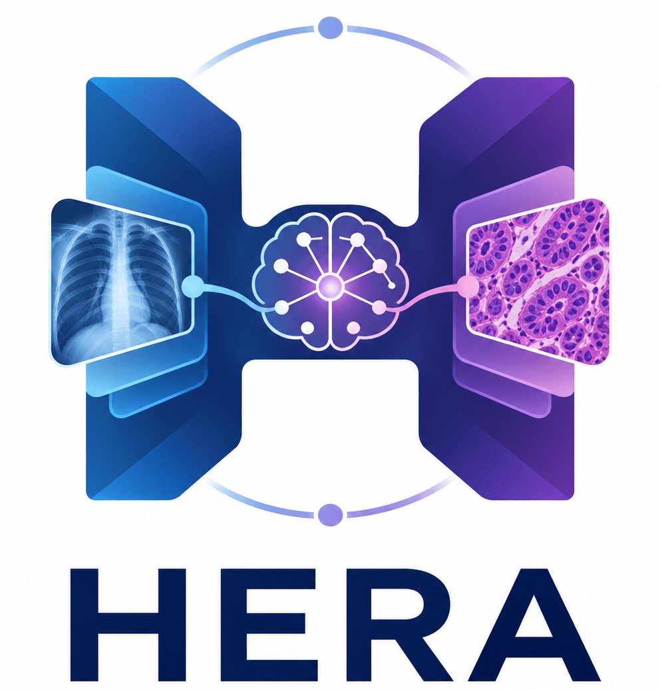

# HERA

<p align="center">
  
</p>


## 1. Installation

From this directory, activate your Python environment and install the dependencies:

```powershell
python -m pip install -r requirements.txt
```

For GPU use, install a PyTorch build suitable for your CUDA environment and ensure that torchvision is compatible with your PyTorch version. The requirements include `timm` and `torchvision` for timm-based teachers, plus `huggingface-hub` and `safetensors` as utilities for external model files. HERA's checkpoint loader does not directly load safetensors files. Online teachers such as CONCH require their official packages and weights to be obtained separately. The optional MUSK-related packages listed in `requirements.txt` do not provide a MUSK adapter; follow the upstream project's instructions if integrating it separately. `requirements.txt` does not lock the complete environment, and the teacher dependency combinations have not been validated with real weights.

Check the installation:

```powershell
python -m hera --help
```

Run the commands below from this directory. Paths in the configuration are relative to the working directory; relative paths in a JSONL manifest are relative to the directory containing that manifest.

## 2. Extract Image Features

To extract features, provide a **stage 2 checkpoint produced by this project's training runner** (for example, `last.pt`) and a two-dimensional image. A training manifest and text tokenizer are not required for image-only extraction. This directory does not contain weights. `load_stage2_encoder` accepts complete stage 2 checkpoints saved by this project's runner; stage 1 weights, standalone state dictionaries, and weights from other models cannot be loaded directly using this interface.

The core calls are shown below. `images` is a `[B, 3, H, W]` tensor prepared using the same preprocessing as training:

```python
from inference import load_stage2_encoder

encoder = load_stage2_encoder("runs/stage2/last.pt", device="cpu")
image_vector = encoder.encode_image(images, modality="radiology")
```

See [inference/extract_image_feature.py](inference/extract_image_feature.py) for complete single-image preprocessing and feature saving. Set the checkpoint path, image path, modality, and output path at the start of the script, then run it from the project root:

```powershell
python -m inference.extract_image_feature
```

The output `.npy` is a one-dimensional feature array that can be read with `np.load("image_feature.npy")`. By default, features are projected and L2-normalized for comparison with text vectors from the same model. To obtain the unprojected image backbone CLS feature, use `encoder.encode_image(images, modality, projected=False)`; its dimension is the model's `hidden_size`.

The script reads the image size and normalization parameters from the checkpoint, converts the image to RGB, applies a fixed PIL bilinear resize, and normalizes it as in the training data pipeline. If the checkpoint was trained with external cropping, slicing, or other custom preprocessing, reproduce those steps before input. CT/MRI volumes must first be converted to the two-dimensional views used during training; `modality` must also match the image domain.

### Extract Image and Text Embeddings

For preprocessed images and text, call the corresponding methods:

```python
image_vector = encoder.encode_image(images, modality="radiology")
text_vector = encoder.encode_text(input_ids, attention_mask)
```

`encoder` is the model loaded above. `input_ids` and `attention_mask` are `[B, L]` tensors produced using the training tokenizer; position 0 must be a valid summary token. The `SentencePieceTokenizer` and `ImageTextCollator` in [hera/data.py](hera/data.py) can be used to process text and form batches. Image and text tensors must be on the same device as the model. The methods return normalized vectors in the contrastive space by default; pass `projected=False` to obtain the unprojected backbone CLS vectors. Inference inputs must use the training tokenizer and image preprocessing.

## 3. Prepare Pretraining Data

Prepare a UTF-8 JSONL file containing one image–text sample per line. For example:

```text
data/
  train.jsonl
  images/
    rad001.png
    path001.png
  tokens/
    rad001.npy
    path001.npy
  features/
    rad001_kad.npy
    path001_uni.npy
```

The following example includes both the stage 1 visual tokens and stage 2 teacher features. You can also prepare separate JSONL files for each stage. File and teacher names are illustrative; use your actual files and configuration:

```jsonl
{"image":"images/rad001.png","text":"A radiology report.","modality":"radiology","visual_tokens":"tokens/rad001.npy","teacher_features":{"KAD":"features/rad001_kad.npy"}}
{"image":"images/path001.png","text":"A pathology description.","modality":"pathology","visual_tokens":"tokens/path001.npy","teacher_features":{"UNI":"features/path001_uni.npy"}}
```

| Field | Contents |
| --- | --- |
| `image` | Image path. |
| `text` | Nonempty text. |
| `modality` | `radiology` or `pathology`. |
| `visual_tokens` | Path to the `.npy` array of discrete visual tokens required for stage 1; alternatively, use the online visual tokenizer described below. |
| `teacher_features` | Mapping from offline teacher names to feature `.npy` paths for stage 2. Cached features for an online teacher may be omitted. |
| `positive_id`, `group_id` | Optional integers. The former specifies true multiple positives; the latter only masks same-group non-positive pairs. Each field must be present for every sample in a batch or omitted for all of them. |

Visual tokens must be a one-dimensional integer array of length `(image_size / patch_size)²`. IDs must be within the model's visual vocabulary; use `-100` for missing positions. Teacher features must be finite, one-dimensional floating-point arrays whose lengths match the configured teacher `dim`. Teacher names within a domain must match the configuration.

The data loader first uses PIL bilinear interpolation to resize each image to `image_size × image_size`, then normalizes it using `data.mean` and `data.std`. Visual tokens and offline teacher features must be generated from the same image and geometric view; visual tokens must also align with the student's patch grid. The fixed resize changes the aspect ratio, so assess whether it is suitable for your data. Before creating the manifest, complete data splitting, patient or slide deduplication, de-identification, and permission checks.

## 4. Configure Training

Reusable model construction, image preprocessing, tokenizer, and loss interfaces are documented in [training/hera_model](training/hera_model/README.md). The training entry point and configuration format are used as follows.

Copy the example configurations and edit the copies. For example, in PowerShell:

```powershell
Copy-Item configs/stage1.example.yaml configs/stage1.yaml
Copy-Item configs/stage2.example.yaml configs/stage2.yaml
```

At a minimum, check the following in both configurations:

1. `tokenizer.model_path`: the path to a real SentencePiece model. `cls_id`, `pad_id`, `mask_id`, and `eos_id`: the actual IDs of the corresponding special tokens in that model. The example IDs are placeholders; the code cannot verify their meaning. List any other user-defined tokens to exclude from masking in `extra_special_ids`.
2. `data.manifest`: the JSONL path for the respective stage. `data.mean` and `data.std`: the student's image preprocessing parameters.
3. `model.vocab_size`, `model.visual_vocab_size`, image size, patch size, and maximum text length: match these to your tokenizers, cached targets, and experimental setup. The `model` configurations for both stages must match to initialize stage 2 from stage 1.
4. Stage 2 `initialize_from_stage1`: the stage 1 `last.pt`. In `distillation.teachers`, specify the actual teacher names, output dimensions, and weights for each domain. The cached and online teachers together must match the configuration for each sample's domain; the same teacher name cannot be provided both online and through cached features. To disable distillation, set `distillation.weight: 0`.
5. `training.steps`, `batch_size`, learning rate, output directory, and other training options: select these according to the available compute and experiment. The example step counts, dimensions, and other hyperparameters are not validated settings for the original experiments.

The project does not provide a pretrained visual tokenizer. In addition to precomputed `visual_tokens`, stage 1 can use `data.visual_tokenizer` with `factory: package.module:callable` and optional `kwargs`. The factory must return a callable that receives a resized RGB PIL image and returns a one-dimensional integer array ordered according to the student's patch grid. Do not provide cached tokens and an online tokenizer for the same data.

## 5. Start Pretraining

```powershell
# Stage 1: produces runs/stage1/last.pt (depending on output_dir in the configuration)
python -m hera --config configs/stage1.yaml

# Check initialize_from_stage1 in the stage 2 configuration before running
python -m hera --config configs/stage2.yaml
```

Logs are printed at the `training.log_every` interval; checkpoints are saved to `training.output_dir/last.pt` at the `training.save_every` interval. Set `keep_step_checkpoints: true` to retain numbered checkpoints as well. On CPU, set `training.amp` to `false`. The example model is large, so first check the workflow with a small model and a small dataset.

Multi-GPU example (adjust the process count to your machine):

```powershell
python -m torch.distributed.run --standalone --nproc_per_node=2 -m hera --config configs/stage1.yaml
python -m torch.distributed.run --standalone --nproc_per_node=2 -m hera --config configs/stage2.yaml
```

`batch_size` is the number of samples per domain, per process, per microbatch. Each optimizer step processes `batch_size × number of domains × number of processes × gradient_accumulation` samples. The trainer samples available domains with equal weight and cycles through shorter domains; each domain must have at least `number of processes × batch_size` samples. Stage 2 negatives are gathered across processes within the same microbatch; gradient accumulation does not combine negatives from different microbatches. The contrastive loss has no effective learning signal when there is only one pair or all negatives are masked.

### Resume Training

Add the following to the configuration for the stage being resumed:

```yaml
training:
  # Keep the existing training settings and add resume
  resume: runs/stage1/last.pt
```

Then rerun the training command for that stage. When resuming stage 2, also remove `initialize_from_stage1`. Resuming requires the same number of processes and the same data, model, and training settings. Any additional random state used by third-party plugins must be managed separately. Load checkpoints and factories only from trusted sources.

## Optional: Online Teachers

Offline cached features are used by default. To run a teacher online, add an `online` entry for it in the configuration, for example:

```yaml
distillation:
  weight: 1.0
  teachers:
    pathology:
      UNI:
        dim: 1024  # adjust for the teacher output
        weight: 1.0
        online:
          factory: hera.teacher_factories:torchscript_encoder
          kwargs: {checkpoint_path: /path/to/trusted_encoder.pt}
          image_size: 224
          mean: [0.5, 0.5, 0.5]  # adjust to the teacher preprocessing
          std: [0.5, 0.5, 0.5]
          output: identity
```

The factory must return a `torch.nn.Module` loaded with the correct weights. `output: identity` expects `[B,D]` output, while `cls` and `mean` expect `[B,N,D]`. `hera.domain_teacher_factories` provides local-weight factories for UNI v1, CONCH v1, and GPFM; these have not been validated with real weights. KAD, CARZero, and Ark require custom factories or offline cached features. Online teachers receive the student's already resized `[0,1]` RGB view and then apply their own resize and normalization; check how this differs from the official preprocessing and cache generation pipeline.

## Pretrained Weights

During peer review, reviewers can access a preview version of the HERA implementation and anonymously access the pretrained weights. The access code is provided in the manuscript's “Code and data availability” section.

The code is being reorganized and may change substantially. Check it before running and use the latest version.

Weights: [Baidu Netdisk](https://pan.baidu.com/s/1Mxj6Q2bjyaJuziQqgWh-UA )

## Acknowledgments

This implementation draws on [BEiT-3](https://github.com/microsoft/unilm/tree/master/beit3), [AM-RADIO](https://openaccess.thecvf.com/content/CVPR2024/papers/Ranzinger_AM-RADIO_Agglomerative_Vision_Foundation_Model_Reduce_All_Domains_Into_One_CVPR_2024_paper.pdf), [GPFM](https://huggingface.co/majiabo/GPFM), and [MUSK](https://github.com/lilab-stanford/MUSK). We thank their authors and the open-source community.

## License

The project code is licensed under [CC BY-NC-ND 4.0](LICENSE): attribution is required, commercial use is prohibited, and modified versions may not be distributed. Third-party software, models, weights, and data are subject to their respective licenses and terms.

## Citation

The formal citation information for the paper and code will be added once confirmed.
